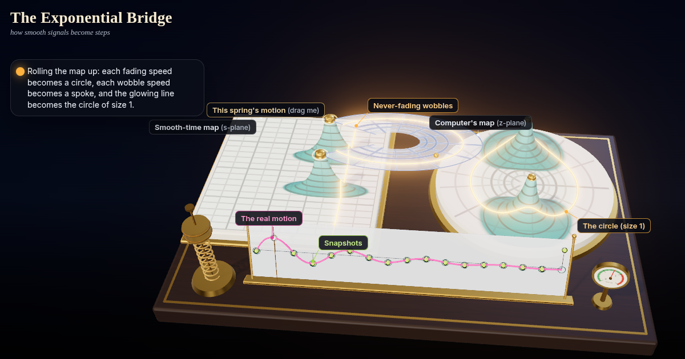

# The Exponential Bridge: how smooth signals become steps

Watch the map of a ringing spring roll up into a computer's map through one formula, z = e^(sT). Drag the spring's motion past the glowing line and it blows up as its twin leaves the circle; sample too slowly and the snapshots trace a fake, slower wave.



**Live demo:** https://interesting-x.scorpion-labs.com/s-to-z/

Inspired by a bookmark from [@mathemetica](https://x.com/mathemetica/status/2104951749622563196).

Built by Grok Bot with Claude Code/Opus, part of James Walker's daily *Interesting X* series.

## Run locally

```bash
npm install
npm run dev      # then open the printed URL (served under /s-to-z/)
npm run build    # static output in dist/
```

## License

MIT © 2026 James Walker
